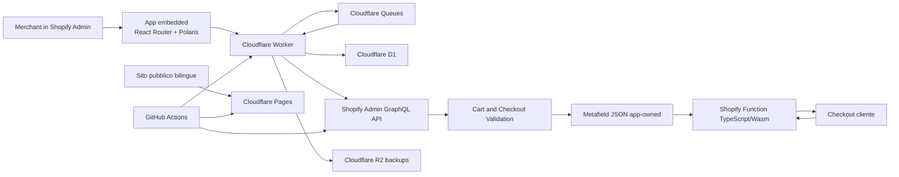

# Architettura

Componenti, confini e contratti di CF Ready. Il codice mostra come sono
realizzati; questo documento fissa ciò che deve restare vero. Le scelte stabili
hanno un [ADR](../adr/), il perché delle altre sta nel
[registro decisioni](../decisions.md).

## Vista logica



Il checkout non chiama mai Cloudflare: la Function gira su Shopify e legge un
solo metafield. Il numero di ordini dei merchant non determina quindi il carico
del Worker.

## Fonti autorevoli

| Informazione | Fonte | Copia |
|---|---|---|
| Regole e messaggi del checkout | Metafield Shopify della Validation | hash e versione in D1; ultima configurazione confermata per il primo paint |
| Validation attiva o disattiva | Oggetto Shopify Validation | stato normalizzato in `app_state` |
| Prova gratuita | D1 | scadenza nel metafield |
| Sottoscrizione e acquisto una tantum | Shopify Billing | stato normalizzato in D1, diritto nel metafield |
| Concessione omaggio | D1, assegnazione manuale dell'owner | diritto senza scadenza nel metafield |
| Sessioni e token | D1 cifrato | nessuna |
| Onboarding e stato UI | D1 | nessuna |
| Paese dello store, solo diagnostico | GraphQL Admin API | `shops.country_code` |
| Fuso dello store, solo per mostrare gli orari | GraphQL Admin API | `shops.iana_timezone` |

La UI non presenta come certo uno stato locale vecchio: la Home disegna subito
l'ultimo stato noto come “in verifica”, con le azioni disabilitate fino alla
conferma (D-167), e prima di ogni mutazione rilevante riconcilia con Shopify.

## Shopify Function

- Tipo: Cart and Checkout Validation Function in TypeScript, target
  `cart.validations.generate.run`.
- Function API e Admin GraphQL API: pin `2026-10`. Ogni cambio di versione,
  query o CLI riconferma il contratto sulle fonti Shopify correnti e rigenera con
  la CLI.
- Trigger: `CHECKOUT_INTERACTION` e `CHECKOUT_COMPLETION`, con un solo algoritmo
  automatico.
- Output: `validationAdd.errors`, al massimo due errori.
- Errore runtime: `blockOnFailure: false` su ogni create e update. Gli errori di
  validazione restituiti di proposito bloccano, un'eccezione imprevista no.
- Limiti dichiarati da Shopify: POS e generazioni successive degli ordini
  ricorrenti non supportati; massimo 25 Validation attive per store.

La query di input richiede solo ciò che serve: step, Paesi di fatturazione e
consegna, opzione selezionata, i due localized fields, data locale dello store e
metafield. Non si allarga “per sicurezza”. Il budget è nessuna iterazione sulle
righe carrello, nessuna rete, nessuna libreria esterna oltre il runtime Shopify.

### Applicabilità

Pseudocodice vincolante:

```text
config = parseConfiguration()
if config invalid or config.enabled != true:
  allow

if entitlement is not active at shop local time:
  allow

if buyerJourney.step not in [CHECKOUT_INTERACTION, CHECKOUT_COMPLETION]:
  allow

if billing country exists and billing country != IT:
  allow

if one or more delivery countries exist:
  if no delivery country is IT:
    allow
  else:
    validate non-empty present fields
    if step == CHECKOUT_INTERACTION and every delivery country is known
       and every Italian delivery group has selectedDeliveryOption:
      validate empty required fields that are present
    if step == CHECKOUT_COMPLETION:
      validate all present fields
      for each required field absent from the input:
        add a global error
else:
  # digital, pickup or no delivery address
  # localized field presence is treated as Shopify's applicability signal
  validate non-empty present fields at Interaction
  validate all present fields at Completion unless billing is foreign
  if step == CHECKOUT_COMPLETION and rules.blockAbsentWithoutDelivery
     and billing country == IT:
    # D-192, opt-in del merchant
    for each required field absent from the input:
      add a global error
```

### Validazione formale

Codice Fiscale di 16 caratteri: funzione pura con tabella delle posizioni,
omocodia, mesi `A B C D E H L M P R S T`, giorno e sesso, limiti per mese,
febbraio al massimo 29, codice catastale e carattere di controllo.

Codice Fiscale di 11 cifre: si sommano le cifre nelle posizioni dispari 1-indexed
e si raddoppiano quelle pari, sottraendo 9 ai risultati oltre 9. L'undicesima
cifra vale `(10 - somma % 10) % 10`. `00000000000` è rifiutato. Il controllo non
prova esistenza, titolarità o corrispondenza anagrafica.

Campo nativo (D-215): dal 6 novembre 2026 Shopify controlla il formato di
`TAX_CREDENTIAL_IT` prima della Function e accetta solo `^[A-Z]{6}\d{2}[A-Z]\d{2}[A-Z]\d{3}[A-Z]$`,
senza maiuscole obbligatorie e senza spazi; non verifica data né carattere di
controllo. Numerici e omocodie non arrivano alla Function. La regola è ricavata
dalle prove e vive solo nel simulatore (`shopifyRejectsValidTaxCode`), che la
usa per una nota; la Function non la replica.

PEC: funzione piccola e leggibile, non una regex RFC. Trim, assenza di spazi, una
sola `@`, parte locale e dominio non vuoti, label valide, punti e trattini in
posizioni lecite, lunghezze ragionevoli.

### Fail-open

Restituiscono zero errori:

- metafield assente, JSON non parsabile o `schemaVersion` sconosciuta;
- `enabled` falso;
- entitlement scaduto o non valido;
- data locale non leggibile;
- campo nativo assente senza una consegna italiana osservabile, salvo D-192 con
  fatturazione italiana;
- contesto geografico escluso;
- eccezione non gestita.

Nei flussi express `cart.localizedFields` può arrivare vuoto: con almeno una
consegna italiana, un campo obbligatorio assente genera un errore globale; senza
consegna osservabile il motore resta fail-open, perché il cliente potrebbe non
avere un campo da compilare. Motivazione ed esiti sono nella
[ricevuta sul rendering](../evidence/2026-07-29-checkout-validation-rendering.md).

### Target degli errori

```text
$.cart.localizedField.TAX_CREDENTIAL_IT
$.cart.localizedField.TAX_EMAIL_IT
$.cart
```

La forma singolare camelCase è quella che rende inline, confermata da Shopify
Developer Support il 30 luglio 2026; il plurale blocca senza messaggio. Il
matching è case-sensitive sulla chiave uppercase. `$.cart` serve ai campi assenti
e, a Completion, ripete ogni errore di campo (D-193).

## Configurazione della Validation

Metafield app-owned sulla Validation:

```text
namespace: $app:cf-ready-validation
key: function-configuration
type: json
```

Il namespace deriva dal Function handle `cf-ready-validation`. Forma, valori
ammessi e default stanno in `app/config.ts`, fuori da un modulo `.server` perché
la UI mostra le stesse opzioni che il server accetta.

- `schemaVersion` corrente è 3. La lettura accetta anche lo schema 2. Il deploy
  verifica prima la Function che legge entrambi, poi il Worker che scrive il 3.
- `validThrough` è una data locale inclusiva per prova e sottoscrizione, `null`
  per una tantum.
- `enabled` è la volontà operativa del merchant e non sostituisce l'entitlement.
- `rules.blockAbsentWithoutDelivery` vale solo se `true` (D-192). Una Function
  che non lo conosce lo ignora e resta fail-open, quindi l'ordine di deploy non
  può bloccare ordini.
- `rules.normalizeOrderFields` vale solo se `true` e con almeno un campo gestito
  (D-206). La Function lo ignora: lo leggono soltanto i job ordini. La variabile
  Worker `ORDER_NORMALIZATION_ENABLED` decide se la pagina Regole la offre e se
  il server ne accetta l'attivazione (D-213).
- `errorDisplay` è legacy: viene scritto sempre `inline` per compatibilità tra
  snapshot Shopify e la Function lo ignora.
- `readConfig(value)` non lancia mai: una configurazione assente, malformata o di
  schema ignoto torna ai default.

## Lifecycle della Validation

`writeValidation` è il percorso unico di salvataggio e attivazione: lease per
store, configurazione intera mai a patch, readback e stato in `app_state`.

- **Creazione.** Nessuna Validation nasce alla sola installazione. Il primo
  salvataggio la crea disattivata, perché il metafield ha bisogno del suo owner.
  L'attivazione è una seconda operazione esplicita.
- **Attivazione.** Autentica, verifica configurazione e diritto, acquisisce la
  lease, riusa la Validation CFR esistente o ne crea una sola, esegue readback e
  registra l'evento. Una transizione ad attiva con diritto `none` è rifiutata.
- **Salvataggio.** Conserva `enabled`, esegue readback e aggiorna hash e versione.
  La firma letta all'apertura della pagina ferma la scrittura se un'altra sessione
  ha cambiato la configurazione (`config_conflict`). L'hash usa un JSON canonico,
  così una riscrittura dei campi da parte di Shopify non sembra un conflitto.
- **Disattivazione.** Chiede conferma, conserva regole, messaggi e identificativo,
  esegue readback.
- **Limite Shopify.** Con 25 Validation attive non si tocca alcuna risorsa di
  terzi: la configurazione resta salvata e il codice è
  `validation_limit_reached`.
- **Duplicati.** Più Validation CFR producono `duplicate_validations`: vengono
  tutte disattivate per restare fail-open, senza sceglierne o cancellarne una. Se
  Shopify non conferma, il codice è `duplicate_validations_active` e `Ripara
  configurazione` ritenta.

La lease D1 serializza create, enable e disable, dove due create concorrenti
lascerebbero risorse duplicate. Per le modifiche alle regole basta il controllo
ottimistico.

## Riconciliazione

`reconcile` è l'unico punto che allinea Shopify e D1. Gira a ogni autenticazione,
all'apertura della Home, dopo i webhook billing, su `shop/update` con Paese
cambiato (salvo lo store D-171), dopo il ritorno da un'approvazione Shopify, dopo
un errore di scrittura e nel ciclo periodico.

1. Legge billing, Validation e metafield da Shopify.
2. Aggiorna lo stato normalizzato in D1.
3. Corregge da sola le divergenze sicure.
4. In caso di ambiguità resta fail-open e mostra un avviso operativo.

L'esito `retryable` è separato da `errorCode`: il primo governa il consumer
webhook, il secondo è il codice sicuro persistito e mostrato alla UI.

### Trigger periodico

Un solo Cron Trigger `*/5 * * * *` per Worker (D-181). Il tick delle :00 UTC
esegue soltanto la retention, che non legge Shopify; gli altri undici eseguono il
ciclo owner. Quest'ultimo rinnova i token in scadenza (D-164, D-178), poi
riconcilia un solo store: prima le sottoscrizioni con fine periodo tra tre giorni
fa e oggi, rilette ogni ora finché il rinnovo non arriva nel metafield, poi le
righe mai tentate, poi gli account obsoleti (24 ore, o ogni ora se il diritto non
è stato scritto). Le fasi finanziarie girano una volta all'ora (D-182).

L'incidente “Billing Shopify da riconciliare” si apre dopo 48 ore senza readback
riuscito e si chiude solo dopo una nuova lettura riuscita, senza dedurre esiti
finanziari dalle transazioni Partner.

## Dati in D1

Lo schema si legge da `migrations/`. `config/migration-policy.json` è il registro
append-only: ordine, SHA-256 e comportamenti protetti devono coincidere con i file
SQL. Una ricostruzione atomica che conserva colonne e righe può dichiarare
`atomic-compatible-table-rebuild`.

Invarianti:

- SQL semplice, prepared statement, niente ORM;
- migrazioni immutabili dopo l'applicazione: una correzione è una migrazione nuova;
- nessuna migrazione distruttiva automatica in Production, con backup e rollback
  prima di una irreversibile;
- timestamp UTC ISO 8601, importi in minor units intere;
- `billing_events` append-only, `billing_accounts` cache operativa;
- `app_events.metadata_json` ammette solo l'allowlist del tipo `EventMetadata`:
  payload, header, token, shop domain, Codice Fiscale e PEC non sono
  rappresentabili;
- `configuration_history` conserva solo l'ultima configurazione confermata, senza
  `enabled`, entitlement, billing, identità staff o dati checkout (D-174);
- `trial_ledger` contiene solo HMAC-SHA-256 del dominio, fine prova e generazione.
  La chiave non ruota come una credenziale di sessione: perderla renderebbe
  irriconoscibili le prove registrate;
- nessuna preferenza lingua salvata: la lingua segue l'utente Shopify.

Dati mai memorizzati: Codice Fiscale, PEC degli acquirenti, ordini, indirizzi,
nomi dei clienti, prodotti o righe carrello, fatture, nazionalità, contenuto
completo dei webhook, segreti in chiaro. L'uniformazione degli ordini (D-206)
legge e riscrive i localized fields di un ordine in memoria, senza conservarli:
in D1 restano solo ricevuta del job e numero di ordini aggiornati.

## Autenticazione e permessi

Scope obbligatorio `write_validations`. Solo quando il merchant attiva il
confronto delle etichette (D-149) si chiedono `write_translations`, `read_locales`
e `read_markets`. Solo quando il merchant attiva l'uniformazione degli ordini
(D-206) si chiedono `read_orders` e `write_orders`, con l'accesso ai protected
customer data di livello 1 senza campi protetti. Mai scope su clienti, prodotti,
inventario, temi, fatture o Storefront API: ogni scope nuovo richiede decisione,
revisione privacy e nuova verifica App Store.

- Flusso del template Shopify React Router, nessun account separato.
- Sessione offline per lo store, online per l'utente; token offline con scadenza e
  refresh.
- Token e payload cifrati AES-256-GCM nel formato `v2.<iv>.<ciphertext>`, con id
  sessione, shop e nome del campo come dati autenticati. Una riga non decifrabile
  equivale a sessione assente: Shopify ripete l'autenticazione. Rotazione in
  [Inventario secret](../runbooks/secret-inventory.md).
- Chiavi diverse tra `dev` e `prod`, cancellazione immediata alla disinstallazione.
- Nessun RBAC interno: chi ha accesso all'app da Shopify può modificare regole e
  messaggi e attivare o disattivare. Gli addebiti restano ai permessi nativi.

Il Paese dello store serve a diagnostica, supporto e telemetria, mai a decidere se
l'app può operare (D-143).

Ogni manifest dichiara in `[network_access] allowed_sources` le sole origini che
il codice dell'app home carica o chiama dal browser: l'origine del Worker
dell'ambiente e `https://tawk.to` per la chat di assistenza (D-210). Le risorse
servite da Shopify non si dichiarano e `allowed_navigation_hosts` resta assente,
perché CF Ready non porta link nello storefront.

## Webhook

| Endpoint | Topic |
| --- | --- |
| `/webhooks/app/uninstalled` | `app/uninstalled` |
| `/webhooks/app/scopes_update` | `app/scopes_update` |
| `/webhooks/shop/update` | `shop/update` |
| `/webhooks/app/billing` | `app_subscriptions/update`, `app_purchases_one_time/update` |
| `/webhooks/compliance` | `customers/data_request`, `customers/redact`, `shop/redact` |
| `/webhooks/orders/create` | `orders/create`, solo `admin_graphql_api_id`, sottoscritto per store (D-211) |

Ogni URI nei manifest è assoluto sull'origine dell'ambiente (D-168). La sezione
`[events]` non è dichiarata (D-186). `orders/create` non sta nei manifest:
Shopify rifiuta un webhook dell'app il cui scope è solo opzionale. L'azione Regole
crea la sottoscrizione per lo store con `webhookSubscriptionCreate` prima di
salvare l'opzione attiva, la ricrea dopo un nuovo permesso e la rimuove quando
l'opzione si spegne (D-211). Le sei route stanno nell'ingresso Worker
leggero, senza React Router.

Percorso comune ([ADR 0002](../adr/0002-webhook-queue.md)):

1. HMAC sui byte originali, senza caricare o rinnovare la sessione: dopo
   `app/uninstalled` il token è già revocato ma la consegna va accettata.
2. `claimWebhook` scrive la ricevuta `processing`. Un claim attivo risponde `500`
   perché Shopify ritenti; un duplicato `processed` riceve `200`.
3. Il Worker pubblica un messaggio minimizzato su Queues e risponde `200` solo dopo
   l'accettazione durevole. Il messaggio non contiene il payload.
4. Il consumer esegue l'handler. Claim ed esito condividono un token: solo il
   proprietario corrente finalizza. Un heartbeat rinnova il claim durante l'handler.

| Confine o stato | Risposta/azione | Stato canonico | Retry o effetto |
|---|---|---|---|
| metodo diverso da `POST` | `405` prima di leggere il corpo | nessun claim | nessuno |
| HMAC non valido | `401` | nessun claim | Shopify può ritentare |
| header o JSON incompleto | `400` | nessun claim | consegna rifiutata |
| corpo oltre 2 MiB dichiarati o reali | `413`, stream cancellato | nessun claim | consegna rifiutata |
| nuova consegna valida | enqueue e `200` | `processing`, claim univoco | consumer asincrono |
| coda assente o enqueue fallito | `500` | nessun claim o `failed` con codice stabile | Shopify ritenta |
| duplicato `processing` non scaduto | `500` senza secondo job | claim originale invariato | Shopify ritenta |
| duplicato `processed` | `200` senza secondo job | `processed` invariato | nessuno |
| claim `processing` scaduto | nuovo token | `processing` | un solo consumer torna proprietario |
| consumer con errore transitorio | retry coda a 10 secondi | `processing` | DLQ a 60 secondi |
| DLQ oltre due tentativi | evento `webhook_failed` e ack | `failed`, `queue_retries_exhausted` | nessuno; D1 indisponibile ritenta |
| claim perso durante handler/finalizzazione | eccezione `webhook_claim_lost` | non sovrascritto | coda ritenta |
| `APP_UNINSTALLED` senza timestamp valido | `500` prima del claim | nessun claim | Shopify ritenta |
| disinstallazione di installazione precedente | nessuna mutazione della reinstallazione | `processed` | fail-open |
| scope senza sessione offline o payload scope assente | nessuna scrittura sessione | `processed` | fail-open |
| redazione shop con installazione attiva | evento `shop_redact_skipped` | `processed` | nessuna cancellazione |
| richiesta o redazione customer | evento `compliance_acknowledged` | `processed` | nessun dato cliente conservato |
| ordine creato senza scope ordini | evento `order_fields_skipped` | `processed` | nessun retry |
| ordine da uniformare | `orderUpdate` dei soli localized fields cambiati, evento `order_fields_normalized` | `processed` | errori Shopify ritentano |
| correzione ordini esistenti | job `ORDER_FIELDS_BACKFILL` con ID sintetico, una pagina da 25 ordini per job | `processed` per pagina | la pagina successiva è un nuovo job |
| update shop con Paese invariato | `200` prima dell'enqueue | nessun claim | nessuna operazione Queue |
| update shop/billing senza contesto admin | evento `*_update_skipped` | `processed` | fail-open |
| riconciliazione shop/billing ritentabile | eccezione con codice stabile | `processing` | coda ritenta |
| riconciliazione non ritentabile | evento `shop_updated`/`billing_updated` | `processed` | fail-open controllato |

Comportamenti per topic:

- `app/uninstalled`: elimina token e sessioni, marca lo store `uninstalled` e avvia
  la finestra di 90 giorni. Claim e ciclo di installazione impediscono che un
  replay tocchi una reinstallazione.
- `shop/update`: un Paese invariato si riconosce subito, senza coda (D-169). Lo
  store di `SHOP_UPDATE_ACK_ONLY_SHOP` risponde senza D1 né coda (D-171). Il Paese
  non cambia mai Validation, prova, billing o configurazione.
- billing: aggiorna evento e cache, riconcilia, scrive il diritto; non attiva una
  Validation disattivata.
- `shop/redact`: cancella solo se l'installazione è ancora `uninstalled`, perché
  Shopify non annulla l'invio dopo una reinstallazione. Le ricevute vengono
  anonimizzate per conservare l'idempotenza dei retry.

## Eventi e codici errore

`recordEvent` è best effort: un errore non interrompe il lifecycle. Gli eventi di
classe `error` e quelli nati da webhook finiscono sempre in Workers Logs, gli altri
sono campionati al 10%. I record ricevono un `correlation_id`, mai lo shop domain.

I codici errore sono valori chiusi, sicuri da mostrare, registrare e confrontare, e
non contengono testo Shopify né dati dello store. Fonte: i tipi in `app/`.

## Notifiche e Control Center owner

L'outbox D1 e il bot Telegram coprono il ciclo merchant, commerciale e operativo
(D-134). La consegna è at-least-once, con massimo cinque tentativi e backoff. Il
contenuto non comunica mai nome dell'owner, email, identificatori Shopify, Codice
Fiscale, PEC o dati checkout. Il Control Center è di sola lettura, salvo la
registrazione delle verifiche di conversione (D-170), e `POST
/internal/telegram/webhook` viene intercettato prima del router merchant, dopo
verifica del secret, della chat privata e del singolo owner. Le cache Partner
conservano solo aggregati. Dettagli operativi in
[operations.md](../runbooks/operations.md#control-center-owner-telegram).

## Cloudflare

Workers per app e webhook, Queues per il lavoro webhook, D1 come unico database,
R2 per i backup, Pages con Web Analytics per il sito, Workers Logs per
l'osservabilità. `cloudflare.config.ts` è l'unica configurazione
([ADR 0004](../adr/0004-cf-cli.md)).

| Ambiente | Worker | Queue webhook | D1 | R2 backup | Jurisdiction |
|---|---|---|---|---|---|
| Development | `cf-ready-dev` | `cf-ready-webhooks-dev` | `cf-ready-db-dev` | nessuno | `eu` |
| Production | `cf-ready-prod` | `cf-ready-webhooks-prod` | `cf-ready-db-prod` | `cf-ready-backups-prod` | `eu` |

Ogni coda ha una DLQ `-failures` nella stessa jurisdiction, che Cloudflare fissa
alla creazione (D-184, D-185).

- Sito: `https://cfready.it/`, con `/privacy`, `/terms`, `/support` e le versioni
  inglesi sotto `/en/`. L'italiano sta nella radice, senza negoziazione automatica
  della lingua. `www` e `cf-ready.pages.dev` reindirizzano con 301, conservando
  percorso e query.
- App: `https://app.cfready.it` in Production, con `workers.dev` disattivato;
  `https://cf-ready-dev.tmsf.workers.dev` in Development. L'App URL è `/app`
  (D-166).
- `robots.txt` versionato: il deploy Pages fallisce se l'edge serve altro (D-152).

Il Worker è progettato per il piano Free: 100.000 richieste al giorno, 10 ms CPU
per richiesta, niente SSR pesante, nessun lavoro costoso in global scope. Soglie,
misure e backup stanno in [operations.md](../runbooks/operations.md).

L'architettura si rivaluta se la CPU `p95` supera il 50% del limite per sette
giorni, se una quota supera il 50% per due periodi, se backup o restore escono dai
tempi documentati, se picchi webhook rendono instabile il modello, o se
l'osservabilità non basta a diagnosticare un P0/P1. Sono stop point, non trigger di
migrazione.

## Scelte scartate

Il razionale è nell'[ADR 0001](../adr/0001-stack.md) e nel registro. Non esiste un
fallback a Hono, Next.js, Express o Remix. App Home UI Extension è riservata alla
custom distribution. KV aggiungerebbe un secondo storage, un ORM non serve a uno
schema piccolo su D1.
